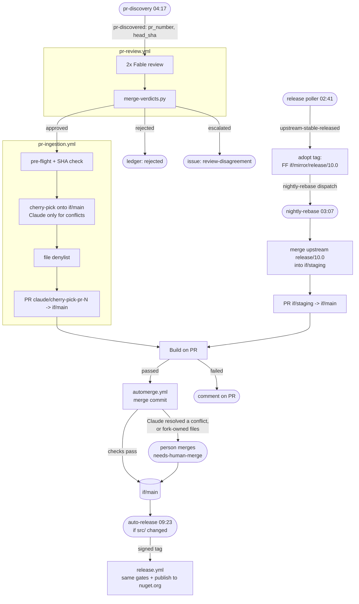

# InitialForce/wpf — Differences from upstream

_Last updated: 2026-04-29 · Branch `if/main` is 238 commits ahead of `upstream/release/10.0` (33 tooling + 205 cherry-picked `src/` commits across 38 community PRs)_

---

## ELI10 — what is this and why does it exist? {#eli10}

**Microsoft's WPF is open source on GitHub.** Skilled community contributors — most prolifically [**h3xds1nz**](https://github.com/h3xds1nz) — regularly fix WPF perf bugs, remove dead code, and clean up boxing/allocation hot-spots. Microsoft merges those fixes into `dotnet/wpf` `main`, but only a slice of them get backported to the stable branch (`release/10.0`) that ships inside .NET 10.

If your app uses stock .NET 10 WPF you only get the slice Microsoft chose to backport. Every "this allocates 40 MB unnecessarily on every layout pass" or "this UI freezes when the GPU cache is on" fix that didn't make the backport cut is invisible to you until the next .NET major version.

**This fork closes that gap.** We take Microsoft's `release/10.0` branch and cherry-pick the merged-but-not-backported community improvements on top, then republish the four WPF runtime DLLs (`PresentationCore.dll`, `PresentationFramework.dll`, `WindowsBase.dll`, `System.Xaml.dll`) as NuGet packages anyone can consume.

### How the package works in your app
You add one `<PackageReference>`. MSBuild targets shipped in the package strip Microsoft's WPF DLLs from your build/publish output and copy our patched DLLs in their place. **Your app's source code does not change.** Your app does not need to know the fork exists.

### What's in the current build
`upstream/release/10.0` + **38 cherry-picked open community PRs** — mostly allocation reduction, boxing removal, `Hashtable`/`ArrayList` → generic collection swaps, dead-code cleanup, and a handful of correctness fixes (Indeterminate `ProgressBar` with `CacheMode`, `AdornerLayer` measuring, `ComboBoxAutomationPeer` cast, etc.). Full per-PR list with upstream links is in [Consumer-facing changes](#consumer-facing-changes) below.

### How safety works
Every candidate PR is reviewed by two independent Claude Fable reviewers before it lands. Hard-fail patterns (`[DllImport`, `unsafe`, `BinaryFormatter`) auto-reject. A change reaches `if/main` only through a PR whose build and smoke gates passed. The perf gates exist but still measure placeholder benchmarks, not WPF (see [Pipeline status](#pipeline-status)). A NuGet version is published only after the same gates pass on the release tag, and only when `src/` changed. Full design is in [The autonomous pipeline](#pipeline).

### How to use it
Replace all four WPF runtime DLLs:
```xml
<PackageReference Include="InitialForce.WPF" Version="10.0.0-if.*" />
```
Or, for selective per-assembly replacement (e.g. only the perf-critical ones):
```xml
<PropertyGroup>
  <IF_OverrideAssemblies>PresentationCore;PresentationFramework</IF_OverrideAssemblies>
</PropertyGroup>
<ItemGroup>
  <PackageReference Include="InitialForce.WPF.RuntimeOverride" Version="10.0.0-if.*" />
</ItemGroup>
```
Both packages are published to [nuget.org](https://www.nuget.org/packages?q=InitialForce.WPF) under Initial Force AS's reserved `InitialForce.*` prefix.

**RID support:** `win-x64` only in v1. Other RIDs (`win-arm64`, `linux-x64`, …) hard-fail with an actionable build error so you discover it at compile time, not runtime.

---

## TL;DR

- **What it is.** A production fork of `dotnet/wpf` (`release/10.0`) maintained by [Initial Force AS](https://initialforce.com). Carries 38 cherry-picked open community PRs not yet in `release/10.0`, shipped as NuGet replacements for WPF's four core runtime DLLs.
- **Why it exists.** Community contributors (notably **h3xds1nz**) merge perf and correctness fixes into `dotnet/wpf` `main` that don't all get backported to `release/10.0`. This fork lets us consume those improvements early, under a safety gate, as production NuGets.
- **What you get today.** Real allocation reductions (`Hashtable` → `Dictionary`/`HashSet`, boxing removal in `DataBindEngine`, `Grid.Measure`, `UncommonField<bool>`, `AutomationPeer`), bug fixes (Indeterminate `ProgressBar` with `CacheMode`, `AdornerLayer` measuring, `ComboBoxAutomationPeer` `InvalidCastException`), and dead-code removal across `PresentationCore` / `PresentationFramework` / `WindowsBase` / `System.Xaml`. Full list: [Consumer-facing changes](#consumer-facing-changes).
- **How autonomous review works.** Every candidate upstream PR is evaluated independently by two Claude Fable reviewers. Disagreements escalate to a human; unanimous approval triggers cherry-pick, build, smoke, and perf gating before the patch lands.
- **Current operational status.** See [Pipeline status](#pipeline-status). The pipeline was repaired in October 2026 after it had stalled since 2026-04-29; the repaired chain has not yet run end to end on GitHub.

---

## At-a-glance diff stats {#diff-stats}

| Metric | Value |
|---|---|
| Commits ahead of `upstream/release/10.0` | **238** (33 tooling/CI + 205 cherry-picked `src/` commits) |
| Total files changed (M + D + A) across all 238 commits | **714** |
| Aggregate line delta | `+44 286 / −11 939` |
| Cherry-picked open community PRs (`dotnet/wpf` PRs not in `release/10.0`) | **38 applied** |
| Cherry-pick attempts skipped due to merge conflicts | **17** (queued for manual resolution — see [conflicted PRs](#conflicted-prs)) |
| New fork-only files (tooling overlay) | **159** |
| Source-only behaviour delta vs upstream `release/10.0` | dominated by allocation reduction and dead-code removal — net negative LOC under `src/` |

---

## Consumer-facing changes {#consumer-facing-changes}

The 38 cherry-picked PRs below are ahead of `upstream/release/10.0` and **all have user-visible impact** — they change allocation behaviour, fix observable bugs, or trim live code paths. Every entry was independently merged into `dotnet/wpf` `main` by Microsoft maintainers and is awaiting backport. Authorship belongs to the upstream contributor (overwhelmingly [@h3xds1nz](https://github.com/h3xds1nz)); this fork only reorders the delivery.

### Performance — allocation & boxing reduction

| PR | Title (consumer impact) |
|---|---|
| [#10237](https://github.com/dotnet/wpf/pull/10237) | Replace boxing `Hashtable` in `AutomationPeer` with `ReadOnlyDictionary<K,V>` — eliminates per-lookup boxing on accessibility tree traversal |
| [#10246](https://github.com/dotnet/wpf/pull/10246) | Remove array allocation during `SystemParametersInfo` cache invalidation — fewer GC-gen0 collections on system theme changes |
| [#10320](https://github.com/dotnet/wpf/pull/10320) | Use stack-allocated/inline arrays with fixed lengths in more places — replaces several short-lived heap arrays with `stackalloc` |
| [#10386](https://github.com/dotnet/wpf/pull/10386) | Remove duplicated PInvoke branch in `Geometry` Milcore call — one fewer indirect call per geometry combine |
| [#10542](https://github.com/dotnet/wpf/pull/10542) | Remove double dictionary lookup for ctor params lookup in `WpfKnownType` — XAML-load-time perf |
| [#10628](https://github.com/dotnet/wpf/pull/10628) | Stop boxing booleans in `DataBindEngine` — uses `BooleanBoxes` cached pair on every binding state transition |
| [#10630](https://github.com/dotnet/wpf/pull/10630) | Optimize `ComputeInkBoundingBox(LtoR)` — removes a redundant branch in stylus/ink hit-testing |
| [#10681](https://github.com/dotnet/wpf/pull/10681) | Avoid boxing booleans and allocations in `UncommonField<bool>` — touches every WPF control with bool flags stored in uncommon-field storage |
| [#10684](https://github.com/dotnet/wpf/pull/10684) | Replace boxing `Hashtable` in `Grid`'s `Measure` — meaningful win for layouts with many `Grid` cells |
| [#10700](https://github.com/dotnet/wpf/pull/10700) | Replace `ArrayList` from `FrameworkElement` with `List<TemplateKey>` — generic, no boxing on template lookup |
| [#10715](https://github.com/dotnet/wpf/pull/10715) | Avoid caching `typeof` result in MilCodeGen output — reduces static-field count and code size |
| [#10719](https://github.com/dotnet/wpf/pull/10719) | Swap `Dictionary<ICyclicBrush, EmptyStruct>` with `HashSet<ICyclicBrush>` in `TreeWalkProgress` — half the storage, faster `Contains` |
| [#10750](https://github.com/dotnet/wpf/pull/10750) | Swap `Dictionary` with `HashSet<XamlMember>` and avoid double lookup — XAML-load-time perf |
| [#10879](https://github.com/dotnet/wpf/pull/10879) | Use `StrongBox<Rect>` over `object` field in `GlyphRun` — strongly-typed, no boxing on rect access |
| [#10880](https://github.com/dotnet/wpf/pull/10880) | Avoid specialized-generic methods for object null checks in `StylusTraceLogger` |
| [#10884](https://github.com/dotnet/wpf/pull/10884) | Avoid boxing booleans during tracing and when setting `bool?` properties |
| [#10889](https://github.com/dotnet/wpf/pull/10889) | Refactor `WeakReferenceList`/`CopyOnWriteList` as type-safe generic collections — removes `object` boxing on every enumeration |

### Bug fixes (correctness)

| PR | Title (consumer impact) |
|---|---|
| [#10289](https://github.com/dotnet/wpf/pull/10289) | Fix `InvalidCastException` in `Can/ConvertTo` from `KeyConverter` — incorrect input no longer crashes the converter |
| [#10617](https://github.com/dotnet/wpf/pull/10617) | Test for `NaN` correctly (CA2242) — avoids latent buggy `NaN` comparisons across geometry/animation code |
| [#10649](https://github.com/dotnet/wpf/pull/10649) | Fix Indeterminate `ProgressBar` animation when `CacheMode` is set — animation no longer freezes on cached visual trees |
| [#10657](https://github.com/dotnet/wpf/pull/10657) | Fix measuring passes in `AdornerLayer` of underlying `Adorner` elements — adorners now invalidate measure when their content changes |
| [#10877](https://github.com/dotnet/wpf/pull/10877) | Fix `InvalidCastException` in `ComboBoxAutomationPeer` and forward `Scroll` to `ItemsControl` base — accessibility tooling no longer crashes against open `ComboBox` |

### Dead code & startup-cost reduction

| PR | Title (consumer impact) |
|---|---|
| [#10641](https://github.com/dotnet/wpf/pull/10641) | Remove NetFX-specific dead code from `DWriteForwarder` compilation — smaller `PresentationCore.dll` |
| [#10680](https://github.com/dotnet/wpf/pull/10680) | Remove unused dead code in `ElementUtil`, make class static — fewer JITed methods at startup |
| [#10874](https://github.com/dotnet/wpf/pull/10874) | Remove non-CLS exception handlers in `LineServicesCallbacks` — dead branches eliminated from text layout hot path |
| [#10875](https://github.com/dotnet/wpf/pull/10875) | Remove non-CLS exception handlers in `PtsHost` |
| [#10876](https://github.com/dotnet/wpf/pull/10876) | Remove non-CLS exception handlers and CS1058 suppressions in PTS callbacks |
| [#10881](https://github.com/dotnet/wpf/pull/10881) | Remove unused dead code in `BamlMapTable` / `XamlTypeMapper` — removes `_reusingMapTable` (always false) and `MapTable.Initialize` |
| [#10882](https://github.com/dotnet/wpf/pull/10882) | Remove `Verify` classes, use standard BCL throw helpers — smaller binaries, consistent argument validation |
| [#10883](https://github.com/dotnet/wpf/pull/10883) | Stop duplicating `Scroll` code in `TreeViewAutomationPeer` — forwards to `ItemsControl` base instead |

### Code generation, build pipeline & style hygiene

These are not user-runtime perf wins on their own, but they propagate into every `MilCodeGen`-generated type (most of `PresentationCore`'s primitive graphics types) and into `PresentationBuildTasks`, so they affect compile-time and the shape of generated code.

| PR | Title |
|---|---|
| [#10618](https://github.com/dotnet/wpf/pull/10618) | [MilCodeGen] Declare `Equals`/`GetHashCode` and property getters as `readonly` on generated structs |
| [#10648](https://github.com/dotnet/wpf/pull/10648) | [MilCodeGen] Optimize generated `ValueSerializers` code style and usings |
| [#10704](https://github.com/dotnet/wpf/pull/10704) | [StyleCleanUp] Specify `StringComparison` for correctness (CA1310) |
| [#10713](https://github.com/dotnet/wpf/pull/10713) | Add tests for the public API surface of `BitmapSizeOptions`, cleanup the class |
| [#10718](https://github.com/dotnet/wpf/pull/10718) | [StyleCleanUp] Static holder types should be `static` or `sealed` (CA1052) |
| [#10725](https://github.com/dotnet/wpf/pull/10725) | [StyleCleanUp] Use literals where appropriate (CA1802) |
| [#10729](https://github.com/dotnet/wpf/pull/10729) | [StyleCleanUp] Add `readonly` modifiers in `PresentationBuildTasks` |
| [#10856](https://github.com/dotnet/wpf/pull/10856) | [MilCodeGen] Allow emitting empty lines via `NULL`, including conditionals — clean diffs in regenerated MilCodeGen output |

### Conflicted PRs (queued for manual resolution) {#conflicted-prs}

The bulk cherry-pick run skipped 17 PRs because they conflicted with upstream `release/10.0` (mostly because Microsoft already partially backported the same change, or because two h3xds1nz PRs depend on each other and only one was resolved cleanly). These are tracked for follow-up:

`#10245`, `#10388`, `#10543`, `#10613`, `#10635`, `#10636`, `#10647`, `#10664`, `#10668`, `#10673`, `#10690`, `#10691`, `#10701`, `#10706`, `#10711`, `#10731`, `#10903`.

Each will be retried with manual conflict resolution in a follow-up release.

---

## Modified upstream files {#modified-files}

| File | Change | Rationale |
|---|---|---|
| `.github/ISSUE_TEMPLATE/config.yml` | `+2 / −21` | Removed upstream contact links (dotnet/runtime, winforms, roslyn, etc.) and disabled blank issues; replaced with a stub that routes to fork-specific issue templates. |
| `.gitignore` | `+10 / −0` | Appended a section for Python toolchain artifacts (`__pycache__/`, `.pytest_cache/`, `.venv/`, etc.) needed by the fork's `tools/` scripts. Upstream content untouched. |
| `README.md` | `+4 / −0` | Prepended a 4-line fork banner above a horizontal rule; all upstream content preserved verbatim below it. |

### Deleted upstream files

| File | Upstream lines | Reason for deletion |
|---|---|---|
| `.github/PULL_REQUEST_TEMPLATE.md` | 23 | Upstream contributor template; not applicable — external PRs are processed via the autonomous ingestion pipeline, not standard GitHub PRs. |
| `.github/workflows/backportPRs.yml` | 28 | Upstream backport-bot workflow triggered by `/backport` comments; superseded by `pr-ingestion.yml`. |
| `.github/workflows/locker.yml` | 36 | Upstream stale-issue locker; issue lifecycle is handled differently in the fork (operator templates + autonomous check). |
| `.github/workflows/main.yml` | 13 | Upstream inter-branch merge workflow triggered on `release/**` push; superseded by `build.yml` and `nightly-rebase.yml`. |
| `CODEOWNERS` | 6 | Upstream `@dotnet/wpf-developers` ownership file; replaced by `.github/CODEOWNERS` covering fork-specific paths and `@oysteinkrog`. |

---

## Added: tooling overlay {#tooling-overlay}

The fork adds 159 files across the following categories. No file in this list modifies any upstream WPF source.

| Category | Files | Key files |
|---|---|---|
| **GitHub Workflows** | 11 | `build.yml`, `nightly-rebase.yml`, `pr-discovery.yml`, `pr-review.yml`, `pr-ingestion.yml`, `release.yml`, `upstream-stable-adoption.yml`, `weekly-differential.yml`, `autonomy-check.yml`, `claude-on-failure.yml`, `test-autonomy-check.yml` |
| **GitHub meta** | 5 | `.github/CODEOWNERS`, 4 issue templates (`cherry-pick-failure`, `perf-regression`, `review-disagreement`, `operator-followup`) |
| **Fork config** | 14 | `.if-fork/config.yaml` (canonical policy), `.if-fork/patch-ledger.jsonl`, `.if-fork/patch-state.json`, `.if-fork/prompts/` (10 Claude prompt files) |
| **Python tools** | 19 | `tools/ledger-event.py`, `tools/ledger-validate.py`, `tools/merge-verdicts.py`, `tools/check-regression.py`, `tools/check-denylist.py`, `tools/dispatch-approved.py`, `tools/release-version.py`, and 12 others |
| **Python tests** | 55 | `tests/` — pytest suite; 646 tests covering all `tools/` scripts and workflow contracts, plus fixture data |
| **Smoke + perf harness** | 26 | `test/InitialForce.WpfSmoke/` — 22-scenario NUnit harness + BenchmarkDotNet perf suite + helpers |
| **Hello-world app** | 7 | `test/InitialForce.WpfHelloWorld/` — minimal WPF app used as build and smoke sanity target |
| **NuGet packaging** | 11 | `packaging/InitialForce.WPF/`, `packaging/InitialForce.WPF.RuntimeOverride/` — SDK-style package projects (no source code; wrap fork assemblies) |
| **Documentation** | 8 | `docs/operator-runbook.md`, `docs/DECISION_LOG.md`, `docs/KNOWN_RISKS.md`, `docs/risk-register.md`, `docs/BOOTSTRAP_STATUS.md`, `docs/known-limitations.md`, `docs/manual-candidates.md`, `docs/autonomy-check-usage.md` |
| **Root-level** | 3 | `NOTICE.md`, `pyproject.toml`, `perf/baseline-example.json` |

---

## The autonomous pipeline {#pipeline}

The pipeline runs without a person in the loop. Each day it finds new community PRs in `dotnet/wpf`, has two Claude Fable reviewers check each one, cherry-picks the approved ones onto `if/main`, and merges upstream `release/10.0` into the fork. Each change reaches `if/main` through a PR that merges itself once the `Build` workflow passes on it. A new NuGet version goes to nuget.org once a day, only after every gate passes, and only when `src/` changed since the last release.

A person is needed only when something escalates: two reviewers disagree, a conflict touches a denylisted file or is too large for Claude, or a workflow keeps failing. Each of those leaves exactly one open issue labelled `automated`. A person also merges every PR that `automerge.yml` refuses: a PR where Claude resolved a conflict (label `needs-human-merge`), and a PR that changes fork-owned files or, for a cherry-pick, anything outside `src/` and `eng/`. `automerge.yml` explains the refusal in a comment on the PR.

### Branches

| Branch | What it is | Who writes it |
|---|---|---|
| `if/main` | The fork: upstream `release/10.0` plus the fork's patches. Default branch. Releases are tagged from here. | PR merges by `automerge.yml` or a person; ledger commits by the bot |
| `if/staging` | The upstream sync candidate: `if/main` with the newest upstream `release/10.0` merged in. Rebuilt from `if/main` whenever upstream moves. | `nightly-rebase.yml` only |
| `claude/cherry-pick-pr-<N>` | One approved upstream PR applied on top of `if/main`. | `pr-ingestion.yml` |
| `if/mirror/release/10.0` | The newest upstream stable tag (`v10.0.<N>`) that the fork has adopted. | `upstream-stable-adoption.yml` |
| `if/release/10.0` | The old release branch from before October 2026. No workflow uses it now; whether to delete it is the owner's decision. | nobody |

`if/main` is never rebased. It has merge commits and its ruleset forbids force pushes, so upstream is merged in.

### Global safety knobs

Three repository variables control autonomous behaviour.

| Variable | Effect |
|---|---|
| `IF_AUTONOMY_ENABLED` | Must be `"true"` for any Claude job, discovery, ingestion, upstream sync or release to run. Otherwise they skip. |
| `IF_AUTOMERGE_FROZEN` | When `"true"`, `automerge.yml` does not merge. PRs stay open with a green build until a person merges them or the freeze is lifted. |
| `IF_REVIEW_DOUBLE_REQUIRED` | Setting to `"false"` activates an emergency single-reviewer path, which needs a manual environment approval and records a `review_single_path_warning` ledger event. |

Other safety layers: `file_denylist` and `commit_denylist` in `config.yaml`, hard-fail patterns that reject any PR containing `[DllImport`, `unsafe`, `BinaryFormatter` and similar, the check that the applied upstream head equals the reviewed head (SHA-smuggling check), and the append-only, GPG-signed, hash-chained ledger.

### Daily schedule (UTC)

| Time | Workflow | What it does |
|---|---|---|
| 02:41 | `upstream-release-poll.yml` | Looks for a new `dotnet/wpf` `v10.0.<N>` tag. If `if/mirror/release/10.0` does not contain it, sends `upstream-stable-released`. |
| 03:07 | `nightly-rebase.yml` | Merges upstream `release/10.0` into `if/staging` and keeps one sync PR to `if/main` open. |
| 04:17 | `pr-discovery.yml` | Finds new community PRs and dispatches up to 10 reviews. |
| 09:23 | `auto-release.yml` | Tags the newest `if/main` commit whose build passed, if `src/` changed since the last release. The tag starts `release.yml`. |
| Every 30 minutes | `automerge.yml` | Goes through every open pipeline PR and merges the ones that pass (it also runs when a `Build` finishes). |
| Mondays 05:23 | `weekly-differential.yml` | Compares smoke results of the fork against its upstream base. |

### Stage by stage

**1. Discovery** (`pr-discovery.yml`, 04:17 UTC). `tools/discover-prs.py` lists upstream open PRs and PRs merged in the last 90 days, keeps community PRs (allowlisted author or "Community Contribution" label), and compares them with the ledger. A `(pr_number, head_sha)` pair is recorded once; a new head SHA is a new candidate. Applied, graduated and rejected PRs are skipped. All new events go into one `[skip ci]` ledger commit. It then dispatches `pr-discovered` with `pr_number` and `head_sha` for at most `discovery.max_reviews_per_run` (10) PRs a day, so the backlog of about 218 PRs takes about 22 days to drain. `dotnet-maestro` and `dotnet-bot` are excluded. No model call. `.if-fork/patch-state.json` is stale and nothing reads it.

**2. Dual review** (`pr-review.yml`). A `prepare` job fetches the PR at the pinned head and writes one `review-input/` artifact: the diff, the file list, `meta.json` and the full changed files. Two Claude Fable reviewers (`claude-fable-5-1` from `claude_models.review_1` and `review_2`, up to 40 turns each) review it independently, as separate jobs with different prompts (`pr-review-1.md`, `pr-review-2.md`). No temperature is set. Each reviewer job has a read-only token and no App token, checks out only `.if-fork/config.yaml` and `.if-fork/prompts/`, loads only trusted Claude settings, may read only `review-input/` and the config, and may write only its own verdict file. Bash, Edit, Glob, Grep, web tools and reads of `/proc` and the runner's `_temp` folder are denied.
- `tools/merge-verdicts.py` combines them: both approve gives `approved`, both reject gives `rejected`, anything else gives `escalated` and one `review-disagreement` issue. The hard-fail patterns, `file_denylist` and the tier confidence floor are applied to the pinned diff before approval.
- Each verdict counts only when its reviewer ID, file hash and upload outcome match its own job. Otherwise it is treated as missing and listed under `origin_errors`, and the run fails after recording.
- A missing verdict, or a failed `prepare` (`review_error` with cause `prepare_failed`), is retried up to 3 times and then escalated.
- The review events are pushed in one ledger commit before `tools/dispatch-approved.py` sends `pr-ingestion-requested` with `pr_number` and `head_sha`.

**3. Ingestion** (`pr-ingestion.yml`).
- `tools/cherry-pick-pre-flight.sh` diffs the whole upstream PR and checks whether the fork already has it. Fully present: `graduated_upstream`, stop. Partly present: `escalated`, stop.
- Every job first checks that `pr_number` is digits and `head_sha` is 40 hex characters. Payload values reach shell only through env.
- The approval check (`tools/check-approval.py`) requires an `approved` outcome in the ledger for the exact `(pr_number, head_sha)`, with no later `rejected` or `escalated` event for that pair.
- The cherry-pick job (`tools/apply-upstream-pr.sh`, no model) checks that the upstream PR head still equals the reviewed SHA and that nothing is on `commit_denylist`. It then applies the change on `claude/cherry-pick-pr-<N>` from `if/main`: a merged PR as its upstream merge commit (`git cherry-pick -x`), an open PR as one commit of its net diff.
- The cherry-pick job records the `if/main` commit it started from. The conflict and `finalize` jobs work on exactly that commit, so a change that lands on `if/main` meanwhile cannot be overwritten.
- Conflicts on denylisted files escalate. Other conflicts go to Claude Sonnet (`cherry-pick.md`, 30 turns) in a separate job with no credentials, no shell and only the action's own settings. A trusted `finalize` job takes only the conflicted files back (see "Where Claude runs" in the [runbook](docs/operator-runbook.md)). Nobody reviews what Claude wrote, so the commit gets the trailer `Conflict-Resolved-By: claude`, the PR gets the label `needs-human-merge`, and a person merges it.
- Before any push, `if/main`'s own `check-denylist.py` and `config.yaml` (from a separate checkout, never the branch's copies) check the whole branch diff against `file_denylist`. That list also holds every fork-owned path (`.github/`, `.if-fork/`, `tools/`, `tests/`, `test/`, `docs/`, `perf/`, `packaging/InitialForce.*` and others) and agent configuration files (`.claude/`, `.mcp.json`, `CLAUDE.md`, `AGENTS.md`). The job then signs, pushes, opens (or reuses) one PR to `if/main`, labelled `automated`, and records `cherry_picked`.

**4. Build** (`build.yml`). Runs on every PR to `if/main` and on pushes to `if/main` that change more than `.if-fork/`, `docs/` or Markdown. Jobs: Python lint and tests, actionlint, the WPF build for x64 and arm64, crossgen, pack, the smoke harness against the packed `.nupkg`, a `perf` job, and an `aggregate` job that fails the run if any gate failed. The `perf` job is a placeholder: no benchmark runs and nothing is measured. `build.yml` never publishes.

**5. Auto-merge** (`automerge.yml`). Runs when `Build` completes for a pipeline PR, every 30 minutes, and by hand. Every run goes through all open pipeline PRs (`tools/automerge-run.sh`), one run at a time, so a run that GitHub drops from the queue loses nothing. A PR is merged with a merge commit when the newest `Build` on its head passed and all of these hold:
- The PR is from this repository, targets `if/main`, comes from `if/staging` or `claude/cherry-pick-pr-<N>`, carries the `automated` label and was opened by this App's bot login.
- `tools/automerge-verify.sh`, run from `if/main`'s own checkout, passes:
  - Every commit is the bot's (signed with the key in `docs/bot-gpg-pubkey.asc`), or upstream's in the sync PR.
  - A cherry-pick PR is one commit whose `Upstream-PR-Head` is approved in the ledger, and it changes only files under `src/` and `eng/`.
  - No file is on `file_denylist`, and no fork-owned file (`.github/`, `.if-fork/`, `tools/`, `tests/`, `test/`, `docs/`, `perf/`, `packaging/InitialForce.*`, agent configuration) changes. For the sync PR this includes changes upstream itself brings.
  - Claude resolved no conflict: no `Conflict-Resolved-By` trailer, and for the sync PR no file differs from git's own merge.
  - The PR contains the current `if/main` tip (ledger-only commits aside).
- `if/main` has not moved between that check and the merge call. GitHub has no merge call that checks the base commit, so a push in the moment between the last fetch and the merge is not caught.

When `if/main` has moved on, it asks `pr-ingestion` or `nightly-rebase` to rebuild the branch instead of merging, once per PR head. A refusal is explained in one comment per PR head; a person merges those PRs. `IF_AUTOMERGE_FROZEN=true` blocks the merge. A PR that only changes `docs/**` or Markdown gets no Build run, so it needs a manual merge. On a failed build it comments on the PR once per head commit; the next passing build merges it. This replaces GitHub auto-merge, which merges at once when a branch has no required checks.

**6. Upstream sync** (`nightly-rebase.yml`). If upstream `release/10.0` is already in `if/main` the job does nothing. If it is already in the open sync PR, the job does nothing either, unless `if/main` has moved on (beyond ledger commits) and the PR holds no Claude resolution: then it rebuilds `if/staging`. If that upstream SHA is already reported blocked (open issue or `rebase_failed` ledger event), it does nothing until upstream moves or someone runs it with `force_rebase`. Otherwise it resets `if/staging` to the `if/main` commit it recorded at the start and runs `git merge --no-ff` of the upstream SHA. The conflict and `finalize` jobs use that same commit.
- Where upstream edits a file the fork deleted under `.github/`, the deletion is kept. Conflicts on denylisted files escalate. Other conflicts go to Claude Sonnet (`resolve-rebase-conflict.md`, 40 turns) in a separate job with no credentials and no shell. A trusted `finalize` job repeats the merge, takes only the conflicted files back, checks them with `if/main`'s tools, and signs the merge commit with the trailer `Conflict-Resolved-By: claude`. That sync PR gets the label `needs-human-merge`, and a person merges it.
- The merge may only touch files upstream changed. The job force-pushes `if/staging` and opens or updates the single PR `if/staging -> if/main`, labelled `automated`. That PR then goes through Build and auto-merge like any other.
- A blocked sync keeps one open issue, "Nightly upstream sync blocked", and records one `rebase_failed` ledger event per upstream SHA. The next successful sync closes the issue.

**7. Upstream stable adoption** (`upstream-release-poll.yml`, `upstream-stable-adoption.yml`). The poller ignores SDK-band tags such as `v10.0.104`, which point at old commits. It skips a tag while an adoption run for it is in flight, and gives up on a tag after three failed runs. Adoption fast-forwards `if/mirror/release/10.0` to the tag and dispatches `nightly-rebase` with `force`, so the sync PR is rebuilt at once. Cherry-picked patches that upstream now contains are found by the ingestion pre-flight check.

**8. Release** (`auto-release.yml`, `release.yml`). `auto-release.yml` creates at most one bot-signed tag a day, for the newest `if/main` commit with a passing build. It skips when that commit is already tagged, or when `src/` is unchanged since the last published release. Before it plans a new tag, it looks at the newest release tag: if that tag is at most 7 days old, has no GitHub Release, and no Release run for it succeeded or is still running, it dispatches `release.yml` for that tag again, up to 3 Release runs per tag, and makes no new tag that day. `release.yml` runs only from `if/main`. `tools/verify-release-tag.sh` checks the tag name, its signature against `docs/bot-gpg-pubkey.asc` from `if/main` (exactly one key, whose fingerprint must equal the `GH_BOT_GPG_FINGERPRINT` secret), and that the commit is on `if/main`. No repository variable is needed for this. The release-notes agent gets the commit list in its prompt and has no tools; if it fails, the GitHub Release uses generated notes. It then runs the same `build.yml` gates on the tagged commit with the tag's version (for example `if-10.0.8-perf.20261008` becomes `10.0.8-if.20261008.1`), runs the perf gate on the pack (placeholder benchmarks, see [Pipeline status](#pipeline-status)), and publishes `InitialForce.WPF` and `InitialForce.WPF.RuntimeOverride` to nuget.org, GitHub Packages and a GitHub Release. Tags must be signed by the bot key and reachable from `if/main`. It records `published` in the ledger. No `.snupkg` is produced, because nuget.org rejects the Windows PDBs the WPF build makes. The PDBs ship inside the `.nupkg`.

**9. Failure reporting** (`claude-on-failure.yml`). When a watched workflow fails on a non-PR run and no issue is open for it, Claude Sonnet writes a short analysis. It reads only the log, a list of recent commits and the config, has no shell, and writes one file. The workflow then opens one issue, "CI failure: <workflow>", and records `failure_analyzed`. Later failures add a comment to that issue. The next successful run closes it.

**10. Weekly differential** (`weekly-differential.yml`). Builds two trees with the fork's tooling: `if/main`, and `if/main` with `src/` replaced by its upstream base. It runs the smoke harness on both and compares them with `tools/diff-smoke-results.py`. A drift or regression keeps one open issue; a clean week closes it.

### End-to-end flow



### Ledger and audit trail

Every pipeline action that changes patch state calls `tools/ledger-event.py`. It appends a JSONL entry with the event type, PR number, head SHA, actor, timestamp and the hash of the previous entry, and commits it with the bot's GPG signature. Batch mode (`--events-file`) writes all events of one run in one commit. Ledger commits carry `[skip ci]` and do not start a build. Changing an old entry breaks every later hash; `tools/ledger-validate.py` checks the chain on every build.

Valid event types are listed in `tools/ledger_schema.py`.

---

## Pipeline status {#pipeline-status}

_As of 2026-10-09._

From 2026-04-29 to 2026-10-07 the pipeline ran every day but moved nothing. Discovery re-recorded known PRs (469 ledger commits in 30 days), no review ran, the nightly job failed every night, and `build.yml` published a NuGet version on every push to `if/main` (24 public versions).

The October 2026 repair (branch `fix/autonomy-pipeline`) changed each stage as described in [The autonomous pipeline](#pipeline). It is checked by the test suite, `ruff` and `actionlint`. It has not yet run on GitHub. The first runs to watch are the nightly sync PR, the first ingestion PR merging itself, and the first `auto-release.yml` tag.

Known gaps:

- **The perf gates measure nothing yet.** The `perf` job in `build.yml` runs no benchmark. The release perf gate runs `test/InitialForce.WpfSmoke/Perf/PerfHarness.cs`, whose benchmarks are placeholder loops, against `perf/baseline.json`, which holds seed numbers that were never measured. A WPF performance regression is not caught by either gate.
- **Secrets are repository secrets.** All seven (`ANTHROPIC_API_KEY`, `GH_APP_ID`, `GH_APP_PRIVATE_KEY`, `GH_BOT_GPG_FINGERPRINT`, `GH_BOT_GPG_KEY`, `GH_BOT_GPG_KEY_ID`, `NUGET_ORG_API_KEY`) are set on the repository, not on an environment. The `environment:` lines in the workflows do not limit them today: any workflow on any branch of this repository can read every secret. The owner will move them into environments limited to `if/main`:

  | Environment | Secrets | Branch policy |
  |---|---|---|
  | `wpf-nuget-publish` | `NUGET_ORG_API_KEY` | `if/main` only |
  | `bot-credentials` | `GH_APP_ID`, `GH_APP_PRIVATE_KEY`, `GH_BOT_GPG_FINGERPRINT`, `GH_BOT_GPG_KEY`, `GH_BOT_GPG_KEY_ID` | `if/main` only |
  | `claude` | `ANTHROPIC_API_KEY` | `if/main` only |

  Before that move, every job that uses one of these secrets must name the environment, or it gets an empty value. Today `automerge.yml` (merge), `auto-release.yml` (tag), `upstream-stable-adoption.yml` and every Claude job have no `environment:` line.
- **Pull requests where Claude resolved a conflict need a person.** See stages 3, 5 and 6.
- **Claude steps may refuse to start when a bot started the run.** `anthropics/claude-code-action` checks that the run's actor is a person unless the actor is listed in its `allowed_bots` input. Reviews dispatched by discovery, ingestion runs dispatched by the bot App, and failure analysis of runs the bot started are such runs. Until this is set, automatic reviews fail. No workflow sets `allowed_bots` yet; the owner decides which App login to list.

Repository settings the pipeline needs:

| Setting | Value |
|---|---|
| Labels `automated`, `needs-human-merge` | `automated` exists; every pipeline PR and issue carries it. The pipeline creates `needs-human-merge` the first time it needs it. |
| Issues | Enabled |
| `IF_AUTONOMY_ENABLED` | `true` |
| `IF_AUTOMERGE_FROZEN` | `false` once the chain is proven; `true` keeps PRs open for a person to merge. It is `true` today. |
| Environment `wpf-nuget-publish` | No required reviewers, so a release publishes without a person. Today it still requires `oysteinkrog`, so every release waits for approval. |
| Environment `branch-promotion` | Requires a reviewer. Used only by the emergency single-reviewer path in `pr-review.yml` (`IF_REVIEW_DOUBLE_REQUIRED=false`), where that approval is the point. |
| Bot GitHub App | Bypasses the `if/main` ruleset. Needs `contents`, `pull-requests` and `issues` write (not verified against the App's current settings). Needs `workflows` write only if upstream ever changes a workflow file (pushing `if/mirror/release/10.0` would carry it). |

## Current state of the patch ledger {#patch-ledger}

**The counts in this section are from 2026-04-29**, when zero patches had been processed through the automated 2× review gate. The ledger then held 223 entries, all in the `discovered` state. They have not been recounted since.

The 38 PRs already on `if/main` (see [Consumer-facing changes](#consumer-facing-changes)) were applied via a human-supervised bulk cherry-pick, **not** the autonomous pipeline.

### Event-type summary

| Event type | Count | Meaning |
|---|---|---|
| `discovered` | 223 | All entries — candidates seeded during bootstrap |
| All other types (`review_1`, `approved`, `cherry_picked`, `published`, …) | 0 | Pipeline not yet live |

### Candidate breakdown by tier

| Tier | Definition | Total | Pre-ledger applied | Pending review |
|---|---|---|---|---|
| **S** | Correctness, thread-safety, perf wins | 106 | 36 | 70 |
| **A** | Allocation reduction, dead-code removal | 83 | 41 | 42 |
| **B** | Style, test coverage, infra improvements | 34 | 21 | 13 |
| **Total** | | **223** | **98** | **125** |

The 98 "pre-ledger applied" entries represent PRs that were already applied to `if/main` before the ledger was established. They are in the ledger for audit completeness only; they do not require pipeline processing.

Of the 125 pending candidates, 116 are already merged into `dotnet/wpf` main and 9 are still open there. None are in `upstream/release/10.0` — that is the selection criterion.

### Aggregate line impact of pending candidates

| Scope | Additions | Deletions | Net |
|---|---|---|---|
| All 223 candidates (aggregate) | +30 808 | −64 719 | −33 911 |
| 125 pending (not yet in fork) | +15 355 | −27 046 | −11 691 |

The strongly negative net reflects the dominant theme: dead-code removal and replacing legacy patterns with leaner, allocation-free equivalents.

### Top tier-S/A candidates (pending)

| PR | Tier | Upstream | Net LOC | Title |
|---|---|---|---|---|
| [#9967](https://github.com/dotnet/wpf/pull/9967) | S | MERGED | +10 | Replace ArrayList with List\<T\> in BamlMapTable |
| [#9468](https://github.com/dotnet/wpf/pull/9468) | A | MERGED | −459 | AvTrace: use params ReadOnlySpan\<object\> |
| [#10021](https://github.com/dotnet/wpf/pull/10021) | B | MERGED | −268 | [StyleCleanUp] Add missing accessibility modifiers (IDE0040) |

The overwhelming majority of tracked candidates originate from **h3xds1nz**, a prolific public contributor to `dotnet/wpf`.

### Manual candidates (outside the automated pipeline)

Five patches in [`docs/manual-candidates.md`](docs/manual-candidates.md) have no `dotnet/wpf` PR number (cross-fork sources: Faithlife/wpf, dotnet-campus/wpf) and require direct operator cherry-pick once Phase 0/1 setup is complete. They are not in `.if-fork/patch-ledger.jsonl`.

---

## What is identical to upstream {#identical}

All paths outside the 38 cherry-picked PRs' touched files remain byte-identical to `dotnet/wpf` `release/10.0` HEAD. Concretely:

- **`eng/`, `tests/`, `Documentation/`, build infrastructure** — untouched. Arcade build configuration, signing, test infrastructure, native build glue, and design docs all match upstream `release/10.0`.
- **`src/` files outside the cherry-picked PRs** — untouched. Every `src/` change is traceable to one of the 38 cherry-picks via `git log -- <file>` and each cherry-pick commit carries a `(cherry picked from commit <upstream-sha>)` trailer for full upstream attribution.

The 33-commit tooling overlay (CI/CD workflows, Python test tooling, NuGet packaging metadata, Claude prompts, ledger data, documentation, root-level config) does not touch any WPF runtime code. No fork-only modifications exist inside `src/` — every byte in there comes from either upstream or a documented upstream PR.

---

## License and relationship to upstream {#license}

This fork is distributed under the **MIT License**, the same license as `dotnet/wpf`. The .NET Foundation retains copyright on all upstream source files. See [`NOTICE.md`](NOTICE.md) for the full attribution and legal text.

The fork is not affiliated with or endorsed by Microsoft or the .NET Foundation.

---

## Phase-0 operator gates {#operator-gates}

The Phase-0 bootstrap is done. The settings the running pipeline depends on are listed under [Pipeline status](#pipeline-status). The original hand-off list is in [`docs/BOOTSTRAP_STATUS.md`](docs/BOOTSTRAP_STATUS.md).

---

## Links {#links}

| Resource | Path |
|---|---|
| Bootstrap status and hand-off recipe | [`docs/BOOTSTRAP_STATUS.md`](docs/BOOTSTRAP_STATUS.md) |
| Operator runbook | [`docs/operator-runbook.md`](docs/operator-runbook.md) |
| Legal attribution | [`NOTICE.md`](NOTICE.md) |
| Fork policy (denylist, tiers, thresholds) | [`.if-fork/config.yaml`](.if-fork/config.yaml) |
| Patch ledger | [`.if-fork/patch-ledger.jsonl`](.if-fork/patch-ledger.jsonl) |
| Manual cherry-pick candidates | [`docs/manual-candidates.md`](docs/manual-candidates.md) |
| Known risks | [`docs/KNOWN_RISKS.md`](docs/KNOWN_RISKS.md) |
| Decision log | [`docs/DECISION_LOG.md`](docs/DECISION_LOG.md) |
| PR discovery workflow | [`.github/workflows/pr-discovery.yml`](.github/workflows/pr-discovery.yml) |
| PR review workflow | [`.github/workflows/pr-review.yml`](.github/workflows/pr-review.yml) |
| PR ingestion workflow | [`.github/workflows/pr-ingestion.yml`](.github/workflows/pr-ingestion.yml) |
| Upstream sync workflow | [`.github/workflows/nightly-rebase.yml`](.github/workflows/nightly-rebase.yml) |
| Auto-merge workflow | [`.github/workflows/automerge.yml`](.github/workflows/automerge.yml) |
| Build workflow | [`.github/workflows/build.yml`](.github/workflows/build.yml) |
| Release workflows | [`.github/workflows/auto-release.yml`](.github/workflows/auto-release.yml), [`.github/workflows/release.yml`](.github/workflows/release.yml) |
